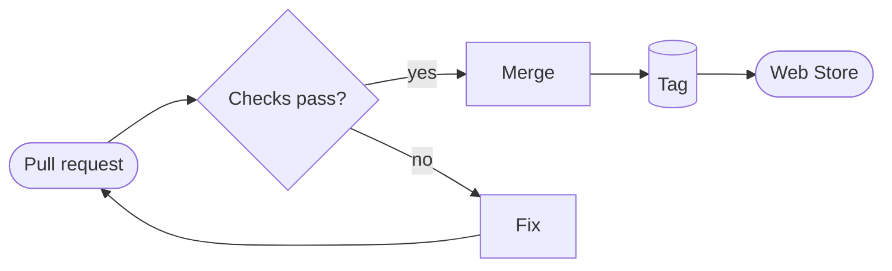

<div align="center">


# Nimbus Markdown

**Mermaid diagrams you can actually explore, right in your browser.**

An interactive Markdown viewer for Chrome. Open any `.md` file and read it as a clean, themed document. Click fullscreen on a diagram to zoom, find a node, follow its links and play it step by step. No editor or upload needed.

[](https://chromewebstore.google.com/detail/nimbus-markdown/kbkjbpmegfjbnpkdmlelkemmolegipkk)
[](https://github.com/dvgamerr-app/nimbus-markdown/stargazers)
[](https://github.com/dvgamerr-app/nimbus-markdown/releases)
[](LICENSE)

[Website](https://dvgamerr.app/nimbus-markdown/) · [Live demo](https://dvgamerr.app/nimbus-markdown/#demo) · [Install](#install-in-a-minute) · [Reference](docs/reference.md) · [ภาษาไทย](README.th.md)


<table>
  <tr>
    <td></td>
    <td></td>
    <td></td>
  </tr>
</table>

**⭐ If Nimbus makes your docs easier to read, star the repo. It helps other developers find it.**

</div>

## Why Nimbus

- **Diagrams are interactive, not pictures.** Fullscreen any Mermaid diagram to zoom, focus a node and watch its links light up, and play sequences, state machines, journeys and timelines step by step. Diagrams are compiled to crisp SVG by [Ondine](https://ondine.sh) and follow your light or dark theme.
- **Built for the docs developers read every day.** README files, design notes, architecture and the Markdown your AI coding agent writes, opened straight from disk.
- **Your file stays on your machine.** Rendering happens in the browser. Local files need one switch, websites only work where you allow them. See the [privacy policy](PRIVACY.md).
- **Free and open source.** MIT licensed, a maintained fork of Markdown Viewer by Simeon Velichkov.

## Features

| | Feature | What you get |
| :-: | :- | :- |
| 🔍 | **Fullscreen diagram viewer** | Zoom, move, find a node (`/`), overview map (`M`), links in blue and out in orange |
| ▶️ | **Playback** | Sequence, state, journey and timeline diagrams play step by step (`P`) |
| 🧭 | **Redrawn diagrams** | Journey maps, timelines, gantt, pie, quadrant, git graph, C4, mindmap and requirement diagrams in one clean style |
| 🗄️ | **DBML schemas** | A ` ```dbml ` block becomes table cards with key chips and routed foreign keys |
| 🎨 | **30+ themes** | Nimbus light and dark, GitHub, and the cleanrmd themes, plus your own CSS |
| 🧮 | **MathJax** | Inline `$…$` and display `$$…$$` formulas |
| 💻 | **Syntax highlighting** | Prism for fenced code blocks, and a highlighted raw Markdown view |
| 📑 | **Table of contents** | A sidebar that follows your scroll |
| 🔄 | **Auto reload** | The preview refreshes when you save a local file |
| ✅ | **GitHub Flavored Markdown** | Tables, task lists, footnotes, emoji and more through markdown-it |

<details>
<summary><b>More screenshots and animations</b></summary>

| Journey playback | Timeline playback |
| :-: | :-: |
|  |  |
| **DBML hover and popup** | **Tables, code and math** |
|  |  |
| **Journey map** | **Timeline in the dark theme** |
|  |  |

Every screenshot is rendered from the mock documents in [docs/showcase](docs/showcase/).

</details>

## Install in a minute

1. Install **[Nimbus Markdown from the Chrome Web Store](https://chromewebstore.google.com/detail/nimbus-markdown/kbkjbpmegfjbnpkdmlelkemmolegipkk)**. It also installs on Chromium browsers such as Edge and Brave.
2. For local files: open `chrome://extensions`, click **Details** on Nimbus Markdown and turn on **Allow access to file URLs**.
3. Drag a `.md` file into the browser.

For Markdown on websites, click the extension icon, open **Advanced Options** and add the site, for example `https://raw.githubusercontent.com`. Details are in [Manage Origins](docs/reference.md#manage-origins).

## Try it

Save this as `flow.md`, open it in Chrome and click the fullscreen button on the diagram:

````markdown
# Release flow


````

Or open the ready-made examples: [docs/showcase](docs/showcase/) and every diagram type in [docs/mermaid.md](docs/mermaid.md).

## How it works

```text
  .md file or allowed site
          │
  background worker ── detects Markdown by path or content type
          │
  content script ──── markdown-it ─► mermaid · dbml · prism · mathjax
          │
  themed page with a table of contents and the fullscreen diagram viewer
```

Plain JavaScript, Manifest V3, Mithril for the settings pages, built into `dist/` with a single Bun script.

## Documentation

- [Reference](docs/reference.md): themes, compiler and content options, origins, manual install
- [Mermaid examples](docs/mermaid.md) and [DBML examples](docs/dbml.md)
- [Firefox notes](firefox.md)
- [Privacy policy](PRIVACY.md) and [changelog](CHANGELOG.md)

## Develop

```bash
bun i
bun run build:dist    # Chrome build in dist/nimbus-markdown
bun test              # unit tests
```

`bun run build:site` assembles the landing page and its live demo in `_site`. Set `PUBLIC_TRACEWAY_DSN` (a Traceway browser DSN, `<ingest token>@<instance>/api/report`) to record visits as Traceway sessions with their clicks; the Pages workflow reads it from a repository secret of the same name.

Load `dist/nimbus-markdown` with **Load unpacked** on `chrome://extensions` (Developer mode on). Use `bun run build:dist:firefox` for Firefox.

## Support the project

- ⭐ [Star the repository](https://github.com/dvgamerr-app/nimbus-markdown/stargazers) so more people find it
- 🐛 [Report a bug or ask for a feature](https://github.com/dvgamerr-app/nimbus-markdown/issues)
- 💬 Leave a review on the [Chrome Web Store](https://chromewebstore.google.com/detail/nimbus-markdown/kbkjbpmegfjbnpkdmlelkemmolegipkk)

## Thanks

- **[simov/markdown-viewer](https://github.com/simov/markdown-viewer)** by Simeon Velichkov. Nimbus is a fork of Markdown Viewer, and its renderer, origin management and themes are the foundation everything here is built on.
- **[cathrynlavery/diagram-design](https://github.com/cathrynlavery/diagram-design)** by Cathryn Lavery. The reference design for how Nimbus draws diagrams: the editorial palette, one focal accent, journey maps, timelines and the rest of the redrawn diagram types.
- The open-source libraries it ships: [markdown-it](https://github.com/markdown-it/markdown-it), [Ondine](https://ondine.sh), [MathJax](https://www.mathjax.org), [Prism](https://prismjs.com), [panzoom](https://github.com/timmywil/panzoom), [cleanrmd](https://github.com/gadenbuie/cleanrmd) and [github-markdown-css](https://github.com/sindresorhus/github-markdown-css).

## License

[MIT](LICENSE).
